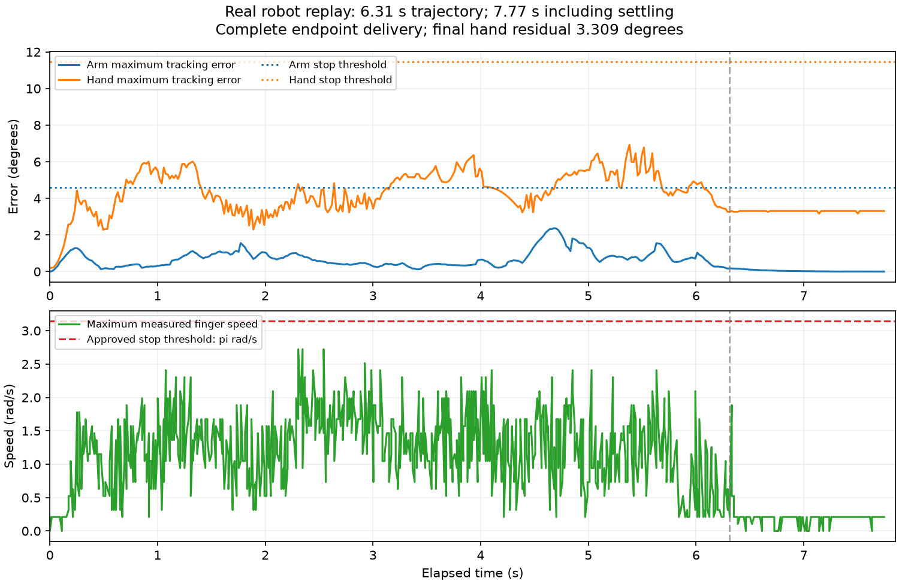
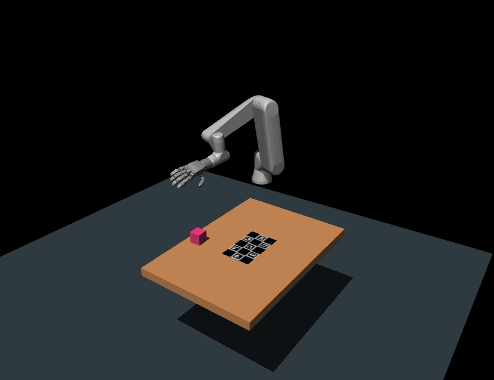
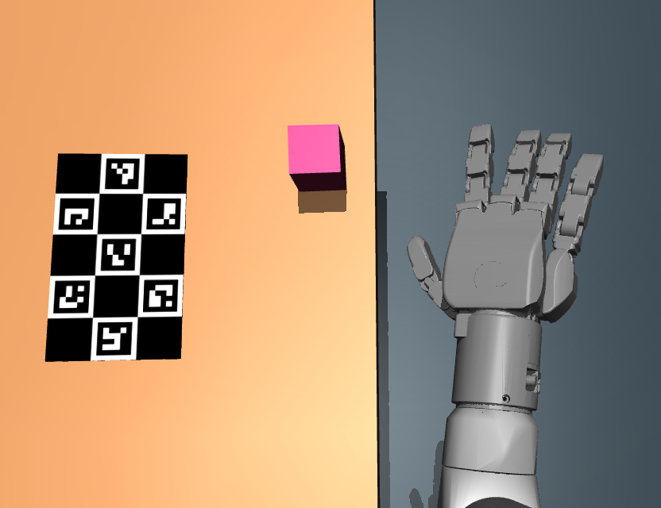

# Replay review evidence — 2026-10-25

## What was reviewed and fixed

- **RTDE freshness:** the normal controller could republish old samples with a new
  wall-clock timestamp. Both controller modes now monitor source timestamp
  advances, stop on stalled/reset/disconnected feedback, and report its age.
  The replay client requires that source age and explicit fault status.
- **Missing hand speed:** the bridge substituted zeros when JointState lacked
  velocities. Such packets now do not refresh the accepted measurement.
- **Fixed reset preflight:** NaN/malformed velocities and missing fault flags
  can no longer pass the stationary-state check.

Focused Python tests cover these failures; a standalone C++ clock test covers
stall, reset, disconnected state and invalid timestamp behavior. The final PR
body records the integrated test result: **251 passed, 4 skipped**. These changes were built and tested
without commanding the physical robot.

## Prior actual execution

The tested retargeted sequence contained 107 source waypoints, spanning 4.4167 s.
All arm and hand targets were delivered. The action took **6.3109 s**, or
**7.7652 s including settling**, and the arm stop was confirmed. The final hand
residual was **0.05775 rad / 3.309°**, so the result is completion with residual
error, not precise convergence. See [machine-readable metrics](real_execution_summary.json).



## Full-arm physics preview

The images and videos below use Simone Cirelli's `AeonLabs/physics_sim` position
drives, the same retarget input, the capture's calibrated table/camera, and a
free cube with estimated size, mass and friction. They do not show a live robot.
The original retarget was replayed; the subsequently shifted live-execution
trajectory is a different artifact.





[Full-arm video](overview.mp4) · [Calibrated-camera video](camera.mp4) ·
[Simulation metrics](simulation_summary.json)

The simulated hand did **not** contact or lift the cube. The closest target
fingertip-to-estimated-cube distance was approximately 232 mm for the robot and
237 mm for the generated MANO hand. Both target trajectories kept fingertips
about 251 mm above the estimated table, while the cube edge was about 67 mm.
This points to a remaining scene/3D-action alignment problem upstream of motor
execution; it does not establish a unique cause. A fresh calibrated capture and
video/3D contact consistency check are still required. Model contact results are
not a certification of physical grasp performance.

To reproduce the preview from available local artifacts:

```bash
brain/pipeline/hand_retarget/.venv/bin/python -m hand_retarget.physics_preview \
  --source /path/to/retarget/result --out /path/to/new/preview \
  --physics-source /path/to/AeonLabs/physics_sim/src \
  --object-config /path/to/paired/estimated_cube.json
```
